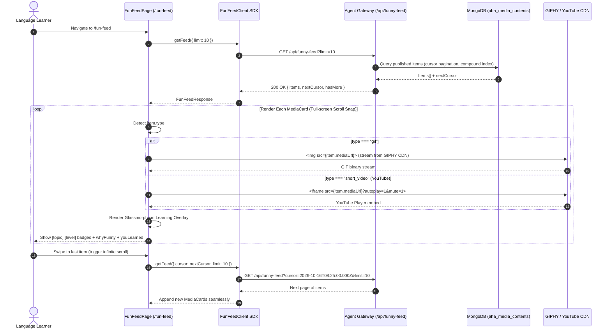
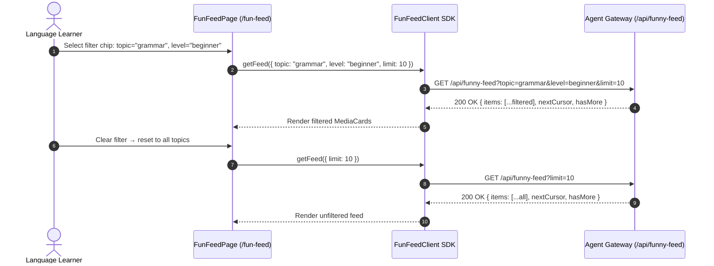
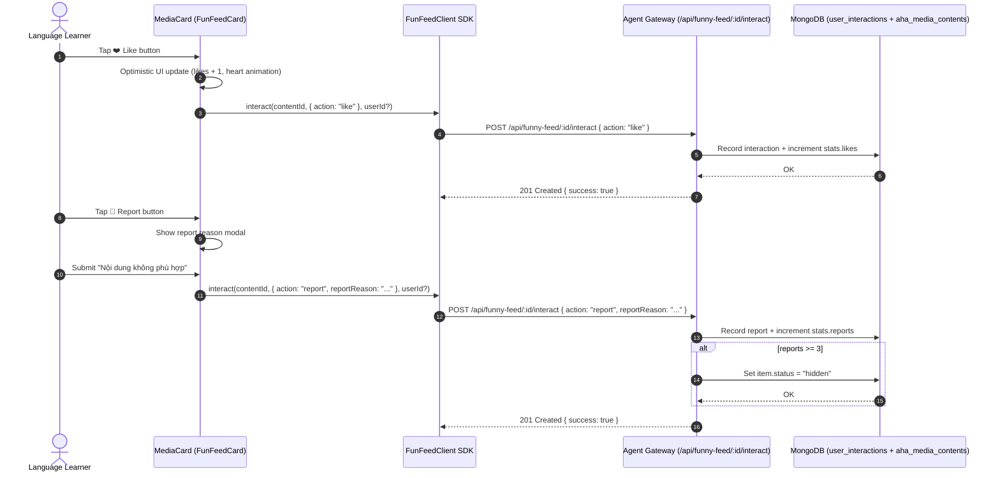

# Module FUN-FEED — Business Specification

> **Parent Document:** [Requirement Analysis Package](../../README.md)  
> **Module ID:** `FUNFEED` | **Domain:** Edutainment Meme & Reel Feed (TikTok-style Vertical Swipe)  
> **Linked Documents:** [API Contract (aha-mind-agents)](fun-feed-api-contract.md) | [Acceptance Criteria](acceptance-criteria.md)  
> **Specification Version:** 1.0.0 (Cursor Pagination + CDN Offload Architecture)

---

## 1. Business Objective

Engage language learners through **bite-sized, humorous English media** (GIFs from GIPHY and YouTube Shorts) curated and enriched by AI, presented in an **Infinite-Scroll TikTok-style vertical feed**. Each piece of content is annotated with AI-generated learning insights (`whyFunny`, `youLearned`) that transform passive scrolling into active vocabulary and grammar acquisition — a **Decoupled Edutainment Feed Architecture** where the `aha-tools` frontend only receives lightweight metadata (~1-2 KB JSON) while media bandwidth is offloaded entirely to GIPHY and YouTube CDNs.

### 1.1. Root Cause Analysis (Tại sao cần Fun Feed?)

| Legacy Pain Point | Fun Feed Solution |
|---|---|
| Học tiếng Anh "khô khan" với flashcard thuần túy dẫn đến burnout | Xen kẽ Meme/Reel hài hước tạo "micro-break" giải trí trong luồng học |
| Nội dung giải trí trên TikTok/Instagram không có annotation học tập | Mỗi GIF/Reel đều kèm giải thích "Tại sao hài" và "Bạn học được gì" |
| Băng thông server tốn kém khi host video/GIF | Zero-bandwidth: media stream trực tiếp từ GIPHY/YouTube CDN |
| Khó lọc nội dung phù hợp trình độ (A1→C2) | Filter theo `topic` + `level` với AI curation tự động |

---

## 2. Functional Requirements

| FR ID | Feature Description | Actor | Pre-condition | Post-condition | Mapped API Endpoint | Target AC |
| :--- | :--- | :--- | :--- | :--- | :--- | :--- |
| **FR-FUNFEED-01** | Browse Fun Feed với Infinite Scroll (Cursor Pagination) | Learner | App shell rendered, `/fun-feed` route loaded | Returns paginated feed items (`≤20` per page) with `nextCursor` for seamless TikTok-style swiping | [`GET /api/funny-feed`](fun-feed-api-contract.md#21-lấy-danh-sách-fun-feed-cursor-pagination-cho-tiktok-swipe) | [`AC-FUNFEED-01`](acceptance-criteria.md#ac-funfeed-01) |
| **FR-FUNFEED-02** | Filter Feed theo Topic & Level | Learner | Feed page rendered | Returns filtered subset of published items matching `topic` and/or `level` query params | [`GET /api/funny-feed?topic=...&level=...`](fun-feed-api-contract.md#21-lấy-danh-sách-fun-feed-cursor-pagination-cho-tiktok-swipe) | [`AC-FUNFEED-02`](acceptance-criteria.md#ac-funfeed-02) |
| **FR-FUNFEED-03** | Render Full-screen Media Card (GIF & YouTube) | Learner | Feed item received with `type` and `mediaUrl` | GIF renders via `` tag streaming from GIPHY CDN; YouTube Shorts renders via `<iframe>` embed with autoplay | — (Client-side rendering) | [`AC-FUNFEED-03`](acceptance-criteria.md#ac-funfeed-03) |
| **FR-FUNFEED-04** | Display Learning Overlay (Glassmorphism Card) | Learner | Media card rendered | Shows topic/level badges, `whyFunny` explanation, `youLearned` insight, and interaction buttons (Like, Save, Report) | — (Client-side rendering) | [`AC-FUNFEED-04`](acceptance-criteria.md#ac-funfeed-04) |
| **FR-FUNFEED-05** | Ghi nhận Tương tác (Like / Save / Skip / Report) | Learner | Feed item visible, optional `x-user-id` header | `POST` interaction is recorded; stats counter on UI updates optimistically; auto-hide if `reports ≥ 3` | [`POST /api/funny-feed/:id/interact`](fun-feed-api-contract.md#22-ghi-nhận-tương-tác-người-dùng-like--save--skip--report) | [`AC-FUNFEED-05`](acceptance-criteria.md#ac-funfeed-05) |
| **FR-FUNFEED-06** | Report Content với Reason Input | Learner | Feed item visible, action = `report` | Report recorded with `reportReason`; if cumulative `reports ≥ 3`, backend auto-hides the item | [`POST /api/funny-feed/:id/interact`](fun-feed-api-contract.md#22-ghi-nhận-tương-tác-người-dùng-like--save--skip--report) | [`AC-FUNFEED-06`](acceptance-criteria.md#ac-funfeed-06) |

---

## 3. User Stories

### US-FUNFEED-01: Browse & Swipe Through Funny English Feed

- **ID:** `US-FUNFEED-01`
- **Actor:** Learner
- **Priority:** Must-have
- **Mapped FR:** [`FR-FUNFEED-01`](#2-functional-requirements), [`FR-FUNFEED-03`](#2-functional-requirements), [`FR-FUNFEED-04`](#2-functional-requirements)
- **Mapped API:** [`GET /api/funny-feed`](fun-feed-api-contract.md#21-lấy-danh-sách-fun-feed-cursor-pagination-cho-tiktok-swipe)
- **Mapped Acceptance Criteria:** [`AC-FUNFEED-01`](acceptance-criteria.md#ac-funfeed-01), [`AC-FUNFEED-03`](acceptance-criteria.md#ac-funfeed-03), [`AC-FUNFEED-04`](acceptance-criteria.md#ac-funfeed-04)

**User Story Statement:**

> As an English learner taking a study break,  
> I want to swipe through a vertical feed of funny English memes and short videos with learning annotations,  
> So that I can absorb grammar and vocabulary insights while being entertained — turning idle scrolling into productive micro-learning.

#### Sequence Diagram

---

### US-FUNFEED-02: Filter Feed by Topic & Level

- **ID:** `US-FUNFEED-02`
- **Actor:** Learner
- **Priority:** Should-have
- **Mapped FR:** [`FR-FUNFEED-02`](#2-functional-requirements)
- **Mapped API:** [`GET /api/funny-feed?topic=...&level=...`](fun-feed-api-contract.md#21-lấy-danh-sách-fun-feed-cursor-pagination-cho-tiktok-swipe)
- **Mapped Acceptance Criteria:** [`AC-FUNFEED-02`](acceptance-criteria.md#ac-funfeed-02)

**User Story Statement:**

> As a beginner English learner focusing on grammar,  
> I want to filter the fun feed by topic (grammar, vocabulary, pronunciation, idiom, conversation) and level (beginner, intermediate, advanced),  
> So that I only see content that matches my current study focus and proficiency level.

#### Sequence Diagram

---

### US-FUNFEED-03: Interact with Feed Content (Like / Save / Report)

- **ID:** `US-FUNFEED-03`
- **Actor:** Learner
- **Priority:** Must-have
- **Mapped FR:** [`FR-FUNFEED-05`](#2-functional-requirements), [`FR-FUNFEED-06`](#2-functional-requirements)
- **Mapped API:** [`POST /api/funny-feed/:id/interact`](fun-feed-api-contract.md#22-ghi-nhận-tương-tác-người-dùng-like--save--skip--report)
- **Mapped Acceptance Criteria:** [`AC-FUNFEED-05`](acceptance-criteria.md#ac-funfeed-05), [`AC-FUNFEED-06`](acceptance-criteria.md#ac-funfeed-06)

**User Story Statement:**

> As a learner viewing a funny English meme,  
> I want to like, save, or report content with immediate visual feedback,  
> So that I can curate my favorites, contribute to community quality control, and the system can learn my preferences over time.

#### Sequence Diagram

---

## 4. Non-Functional Requirements

| NFR ID | Requirement | Target |
|---|---|---|
| **NFR-FUNFEED-01** | **Zero Server Bandwidth for Media:** All GIF/Video streams must be served directly from GIPHY/YouTube CDN. `aha-mind-agents` only serves metadata JSON (~1-2 KB per item). | 0 bytes media bandwidth on origin server |
| **NFR-FUNFEED-02** | **Instant Playback:** GIF autoplay must begin within 500ms of scroll-snap into view. YouTube Shorts embed must auto-play with `mute=1`. | < 500ms First Meaningful Paint per card |
| **NFR-FUNFEED-03** | **Smooth Scroll Experience:** CSS `scroll-snap-type: y mandatory` must produce 60 FPS swipe transitions on mobile Safari and Chrome. | 60 FPS scroll performance |
| **NFR-FUNFEED-04** | **Cursor Pagination Scalability:** Feed query must use compound index on `{ status: 1, publishedAt: -1 }` ensuring O(log n) lookup regardless of collection size. | < 50ms query latency at 100K documents |
| **NFR-FUNFEED-05** | **Optimistic UI Updates:** Like/Save interactions must reflect immediately in the UI before server confirmation, with rollback on failure. | < 100ms perceived response time |

---

## 5. Trade-off Analysis

| Decision | Benefit | Trade-off |
|---|---|---|
| **Cursor-based pagination** (vs. offset) | O(1) consistency trên large datasets, không bị skip/duplicate khi có insert mới | Không hỗ trợ "nhảy" tới trang N trực tiếp — phù hợp TikTok-style infinite scroll |
| **CDN offload** (GIPHY/YouTube embed) | Zero bandwidth cost, instant global delivery | Phụ thuộc vào uptime của third-party CDN; mất kiểm soát nếu content bị xóa tại nguồn |
| **Optimistic UI** cho interactions | UX mượt, cảm giác phản hồi tức thì | Cần rollback logic nếu server reject; potential temporary inconsistency |
| **Glassmorphism overlay** | Premium visual, không che mất media | Accessibility concern trên low-contrast screens — cần đảm bảo WCAG AA contrast ratio |

---

*Made by Anh Tu - Share to be share*
